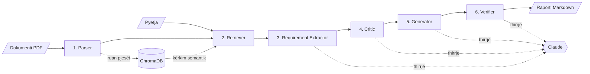

# TechSpec-MultiAgent-RAG

Sistem me shumë agjentë (Multi-Agent) për analizën e dokumentacionit teknik dhe të manualeve softuerike. Nga një dokument PDF dhe një pyetje, sistemi nxjerr kërkesat softuerike dhe pikat API, vlerëson cilësinë e kërkesave, gjeneron raste testimi dhe verifikon që çdo rezultat mbështetet te dokumenti.

Projekt i temës së diplomës Bachelor në Shkenca Kompjuterike dhe Inxhinieri Softuerike.

## Arkitektura

Gjashtë agjentë të specializuar ekzekutohen me radhë në një graf [LangGraph](https://langchain-ai.github.io/langgraph/). Pas çdo agjenti, grafi vazhdon vetëm nëse nuk është shënuar asnjë gabim; përndryshe ndalon menjëherë, që agjentët pasardhës të mos punojnë me të dhëna të paplota.



| # | Agjenti | Çfarë bën | Modeli gjuhësor |
|---|---|---|---|
| 1 | **Document Parser** | Lexon PDF-në, gjen titujt e seksioneve, e ndan në pjesë me mbivendosje brenda secilës faqe dhe i ruan në ChromaDB. | Jo |
| 2 | **Retrieval** | Gjen pjesët më relevante për pyetjen me kërkim hibrid (semantik + fjalë kyçe), vetëm brenda dokumentit aktual. | Jo |
| 3 | **Requirement Extractor** | Nxjerr kërkesat funksionale dhe jofunksionale dhe pikat API. Çdo kërkesë citon pjesët ku mbështetet; citimet e shpikura hiqen. | Po |
| 4 | **Quality Critic** | Kontrollon çdo kërkesë sipas 5 kritereve (qartësia, ambiguiteti, testueshmëria, matshmëria, plotësia) dhe propozon një version të përmirësuar. | Po |
| 5 | **Test & Documentation Generator** | Shkruan raste testimi (pozitive, negative, kufitare) dhe ndërton raportin Markdown me matricën e gjurmueshmërisë. | Po, vetëm për testet |
| 6 | **Citation & Fact-Verifier** | Kontrollon që kërkesat, versionet e përmirësuara dhe testet nuk shtojnë supozime që dokumenti nuk i përmban. | Po |

### Vendime kryesore të dizajnit

- **Kërkim hibrid.** Kërkimi semantik gjen tekste me kuptim të ngjashëm, por shpesh humbet termat e saktë si emrat e API-ve, kodet e gabimeve ose numrat. Prandaj renditja semantike bashkohet me BM25 (fjalë kyçe) përmes Reciprocal Rank Fusion. Në një provë me 6 pyetje mbi `data/sample_doc.pdf`, termi i kërkuar u gjet te 3 rezultatet e para në 6 raste me kërkimin hibrid dhe në 4 me atë vetëm semantik.
- **Seksionet e dokumentit.** Titujt njihen nga madhësia e shkronjave (të paktën 1.2 herë më të mëdha se teksti kryesor). Çdo pjesë merr titullin e fundit para saj, ndaj citimet tregojnë si faqen ashtu edhe seksionin, p.sh. "3 (Benefits)".
- **Përgjigje të strukturuara.** Modeli kthen JSON sipas skemave Pydantic, jo tekst të lirë.
- **Gjurmueshmëri.** Çdo kërkesë mban ID-të e pjesëve të dokumentit ku mbështetet, dhe çdo test mban ID-të e kërkesave që verifikon.
- **Pa vlera të shpikura.** Kur dokumentit i mungon një vlerë, modeli shkruan `[TBD: ...]` në vend që ta shpikë.
- **Numra të përsëritshëm.** Përqindja e cilësisë llogaritet nga kodi sipas kritereve që nuk plotësohen (çdo kriter vlen 20%), jo nga modeli.
- **Raport pa modelin gjuhësor.** Dokumentacioni Markdown ndërtohet nga kodi me të dhënat e gjendjes, ndaj nuk mund të përmbajë tekst të shpikur.
- **Kosto e ulët.** Modeli i paracaktuar është `claude-haiku-5-5` ($0.10 / $0.50 për milion tokena), 20 herë më i lirë se `claude-sonnet-5-5`. 80% e kostos së një analize vjen nga tokenat dalës, ndaj udhëzimet u kërkojnë agjentëve shpjegime të shkurtra. Me Sonnet ose Opus aktivizohet edhe modeli rezervë i Anthropic (`fallbacks: "default"`) për kërkesat që refuzohen nga filtrat e sigurisë.
- **Gabime të qarta.** Çdo gabim i API-së (çelës i pavlefshëm, kufi kërkesash, model i tërhequr, mungesë interneti) shfaqet si mesazh në shqip, pa e rrëzuar aplikacionin.

## Teknologjitë

| Fusha | Teknologjia |
|---|---|
| Gjuha | Python 3.12 ose më i ri (testuar me 3.14) |
| Orkestrimi i agjentëve | LangGraph |
| Modeli gjuhësor | Claude (Anthropic API) përmes `langchain-anthropic`, me dalje të strukturuara (`json_schema`) |
| Baza vektoriale | ChromaDB, me modelin lokal të embedding-ut `all-MiniLM-L6-v2` |
| Leximi i PDF-ve | pypdf |
| Ndërfaqja | Streamlit |
| Testet | pytest |

## Struktura e projektit

```
app.py                    Ndërfaqja Streamlit
src/
  config.py               Konfigurimi dhe lidhja me Claude
  state.py                Gjendja globale që ndajnë agjentët (TechSpecState)
  graph.py                Grafi LangGraph me 6 agjentët
  agents/                 Agjentët: parser, retriever, requirement, critic, generator, verifier
  utils/
    pdf_loader.py         Leximi dhe ndarja e PDF-ve
    vector_db.py          Ruajtja dhe kërkimi hibrid në ChromaDB
    keyword_search.py     Kërkimi me fjalë kyçe (BM25) dhe bashkimi i renditjeve (RRF)
    sources.py            Formatimi i pjesëve dhe i burimeve (faqja, seksioni)
    llm.py                Thirrja e përbashkët te modeli dhe trajtimi i gabimeve
    analysis_io.py        Ruajtja dhe hapja e një analize si JSON
tests/                    Testet automatike (pa internet dhe pa kosto)
data/                     Dokumentet PDF shembull
```

## Instalimi

```bash
git clone https://github.com/Ferideramadani/TechSpec-MultiAgent-RAG.git
cd TechSpec-MultiAgent-RAG
python -m pip install -r requirements.txt
```

Krijo skedarin `.env` në rrënjën e projektit me çelësin e Anthropic, të cilin e krijon te [console.anthropic.com](https://console.anthropic.com). API-ja është me pagesë, ndaj llogaria duhet të ketë kredit:

```
ANTHROPIC_API_KEY=çelësi_yt
```

Skedari `.env` është i përjashtuar nga git dhe nuk duhet ndarë me askënd.

### Variabla opsionale

| Variabla | Vlera e paracaktuar | Përdorimi |
|---|---|---|
| `TECHSPEC_CLAUDE_MODEL` | `claude-haiku-5-5` | Modeli Claude. `claude-sonnet-5-5` jep cilësi më të lartë për rreth 20 herë më shumë kosto. Anthropic i tërheq modelet e vjetra herë pas here; atëherë ndrysho këtë vlerë. |
| `TECHSPEC_MAX_TOKENS` | `16000` | Gjatësia maksimale e një përgjigjeje. |
| `TECHSPEC_TIMEOUT_SECONDS` | `300` | Koha maksimale e pritjes për një thirrje. |
| `TECHSPEC_MAX_RETRIES` | `2` | Sa herë riprovohet një thirrje që dështoi. |
| `TECHSPEC_CHROMA_DIR` | `chroma_db/` | Dosja e bazës vektoriale. Nëse projekti është brenda OneDrive, vendose jashtë tij, sepse sinkronizimi mund të bllokojë skedarët e bazës. |

## Përdorimi

```bash
python -m streamlit run app.py
```

1. Zgjidh një PDF nga dosja `data/` ose ngarko një të re.
2. Shkruaj pyetjen në anglisht, p.sh. *"What security capabilities must an API management solution provide?"*
3. Kliko **Analizo**. Analiza zgjat rreth 1 deri në 2 minuta; ndërfaqja tregon çdo agjent sapo përfundon.

Rezultatet shfaqen në skeda: Kërkesat, Cilësia, Testet, Verifikimi, Dokumentacioni (me shkarkim `.md`) dhe Burimet.

Herën e parë, ChromaDB shkarkon modelin e embedding-ut (rreth 80 MB) te `~/.cache/chroma`.

### Analizat e ruajtura

Butoni **Ruaj analizën (.json)** e ruan rezultatin e plotë. Te paneli anësor, **Hap një analizë të ruajtur** e shfaq përsëri pa thirrur modelin gjuhësor. Kjo është e dobishme për prezantime, sepse nuk varet nga interneti, nga API-ja dhe nuk ka kosto.

## Testet

```bash
python -m pip install pytest
python -m pytest tests -q
```

Testet nuk kanë nevojë për çelës API dhe nuk dalin në internet. Ato përdorin modelin real të LangChain kundrejt një serveri lokal që imiton API-në e Anthropic, dhe një bazë vektoriale të përkohshme. Mbulojnë agjentët një nga një, grafin e plotë (përfshirë ndalimin pas çdo gabimi) dhe ndërfaqen Streamlit.

## Kufizimet

- **Rezultatet ndryshojnë.** Modeli gjuhësor mund të nxjerrë numër të ndryshëm kërkesash nga një ekzekutim te tjetri.
- **Kosto.** Çdo analizë bën 4 thirrje te Claude. Me `claude-sonnet-5-5` një analizë e ShopFlow kushtoi $0.195; me `claude-haiku-5-5` çmimi për token është 20 herë më i ulët. API-ja mund të kthejë edhe gabime të përkohshme (529) ose kufi kërkesash (429).
- **Gjuha.** Modeli i embedding-ut është trajnuar kryesisht për anglishten, ndaj kërkimi me pyetje në shqip është më i dobët.
- **PDF të skanuara.** Nuk mbështeten, sepse sistemi nuk bën OCR.
- **Seksionet.** Gjenden vetëm kur titujt kanë shkronja më të mëdha se teksti; titujt që dallohen vetëm me shkronja të trasha (bold) nuk njihen.
